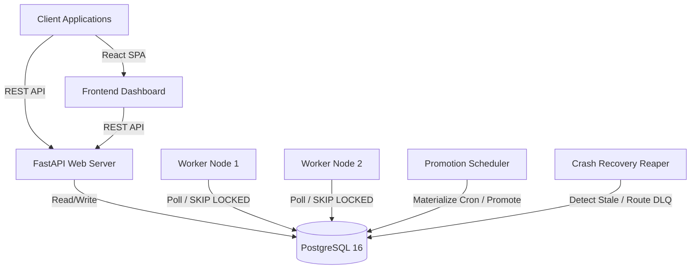

# System Architecture

The Distributed Job Scheduler is built for high concurrency, durability, and at-least-once execution semantics within the constraints of a purely relational database architecture (PostgreSQL).

## High-Level Architecture



## Component Roles

1. **API Gateway (FastAPI)**: Serves REST endpoints for managing projects, queues, jobs, and policies. It directly reads and writes to PostgreSQL.
2. **Worker Nodes (Python asyncio)**: Pull jobs from queues using atomic `SELECT FOR UPDATE SKIP LOCKED`. Each worker maintains a fixed concurrency limit using an `asyncio.Semaphore`.
3. **Promotion Scheduler**: Runs periodically to move `SCHEDULED` or `RETRY_WAIT` jobs into `QUEUED` state, and materializes `ScheduledJob` occurrences (cron/one-time) into concrete `Job` rows.
4. **Crash Recovery Reaper**: Scans for `DEAD` workers (no recent heartbeats) and expired leases. It routes aborted jobs back to `RETRY_WAIT` or the `DLQ`.
5. **PostgreSQL**: The central state store and synchronization primitive. It acts as both a durable datastore and an atomic queue broker.

## Concurrency and Locking Strategy

To avoid using Redis or Kafka, the system leverages advanced PostgreSQL locking mechanisms:

1. **Queue Capacity Locking**: When a worker attempts to claim jobs, it first locks the target queue (`SELECT ... FOR UPDATE`). This allows it to calculate available concurrency slots safely.
2. **SKIP LOCKED Claiming**: After determining available slots, the worker pulls jobs using `SELECT ... FOR UPDATE SKIP LOCKED`. This prevents multiple concurrent claimers from successfully claiming the same available job row during the claim transaction, while avoiding unnecessary blocking on already locked candidate rows.
3. **Claim Tokens, Worker Heartbeats, & Optimistic Leasing**: Once a job is claimed, a `claim_token` UUID is generated. All subsequent state transitions require this token, ensuring strict ownership. Workers emit heartbeats to report process liveness. Separately, active job executions renew their own leases. If a worker crashes, heartbeats stop, job leases eventually expire, and the Reaper recovers eligible interrupted work.

## Backend Code Layout

The backend is layered so that SQL lives in one place and each background process is a thin loop over a service:

```
backend/app/
├── api/            HTTP layer: routes + auth/ownership dependencies. No SQL.
├── services/       Business logic and transaction orchestration.
├── repositories/   Persistence primitives. The only package that issues SQL.
├── worker/         Long-running process runtime (worker, scheduler, reaper loops).
├── models/         SQLAlchemy ORM models.
├── schemas/        Pydantic request/response models.
├── core/           Settings, enums, exceptions, logging, security.
└── db/             Engine, session factory, declarative base.
```

Dependencies point downward only: `api` → `services` → `repositories` → `models`. The `worker` package calls `services` for job state transitions and uses repositories directly only for its own bookkeeping: worker registration, heartbeats, and the list of unpaused queues.

### Repositories (`app/repositories/`)

Repositories expose queries, row locks (`FOR UPDATE`, `FOR UPDATE SKIP LOCKED`) and inserts. They **never commit**, so callers decide transaction boundaries. Timestamps that coordinate processes use the database clock through the helpers in `expressions.py` (`db_now()`, `db_now_plus_seconds()`, …).

| Repository | Owns |
|---|---|
| `job_repository` | atomic claim, row locks for transitions, lease renewal, promotion / lease-expiry scans, status counts |
| `queue_repository` | queue lock for capacity checks, active-job counts, ownership lookups |
| `execution_repository` | per-attempt `job_executions` rows and their finalization |
| `job_log_repository` | append-only `job_logs` |
| `dlq_repository` | `dlq_entries` creation and owner-scoped lookups |
| `worker_repository` | worker registry, heartbeats, stale-worker scan |
| `schedule_repository` | `scheduled_jobs` CRUD and the due-schedule scan |
| `user_` / `project_` / `retry_policy_` / `batch_repository` | CRUD and owner-scoped lookups |

### Services (`app/services/`)

| Service | Responsibility |
|---|---|
| `claim_service` | Queue-capacity-checked atomic claiming; lease renewal |
| `execution_service` | `start_execution` / `complete_job` / `fail_job` transitions, with ownership checked via `(worker_id, claim_token)` |
| `retry_service` | Retry delay math; `retry_or_dead_letter`, the single path that sends a failed attempt to `RETRY_WAIT` or the DLQ; manual DLQ retry |
| `recovery_service` | Reaper logic: mark stale workers `DEAD`, recover expired leases |
| `metrics_service` | Queue and batch status counts |
| `schedule_service` | Cron math, delayed/retry promotion, schedule materialization |
| `job_service`, `batch_service`, `auth_service` | Job creation/idempotency, batch creation, authentication |

Both a handler failure (`execution_service.fail_job`) and a crashed worker (`recovery_service.reap_expired_jobs`) go through `retry_service.retry_or_dead_letter`, so retry backoff and DLQ handoff behave the same in both cases.

### Worker runtime (`app/worker/`)

| Module | Responsibility |
|---|---|
| `runner` | `WorkerRunner`: registers the worker, runs the poll/claim loop, and puts the modules below together |
| `executor` | `JobExecutor`: runs one claimed job (start → handler → complete/fail) and renews its lease in the background |
| `heartbeat` | Worker registration, status updates, and the `HeartbeatEmitter` liveness loop |
| `shutdown` | `ShutdownCoordinator` (draining → stop), signal handling, bounded drain of in-flight tasks |
| `reaper` | `ReaperScheduler` loop over `recovery_service` |
| `scheduler` | `PromotionScheduler` loop over `schedule_service` |
| `handlers` | Registry of safe, deterministic job handlers |

**Graceful shutdown** happens in two phases. On SIGTERM/SIGINT the worker enters *draining* right away and stops claiming. It then records `DRAINING` in the database, and only after that does it signal *stop*. Stop wakes the poll loop at once rather than letting it finish its poll interval. The worker then waits up to `WORKER_SHUTDOWN_GRACE_SECONDS` for in-flight jobs and marks itself `OFFLINE`. The ordering guarantees the `OFFLINE` write always lands after the `DRAINING` write.
