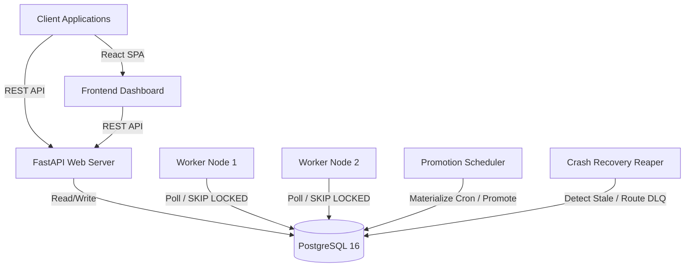

# System Architecture

The Distributed Job Scheduler is built for high concurrency, durability, and at-least-once execution semantics within the constraints of a purely relational database architecture (PostgreSQL).

## High-Level Architecture

## Component Roles

1. **API Gateway (FastAPI)**: Serves REST endpoints for managing projects, queues, jobs, and policies. It directly reads and writes to PostgreSQL.
2. **Worker Nodes (Python asyncio)**: Pull jobs from queues using atomic `SELECT FOR UPDATE SKIP LOCKED`. Each worker maintains a fixed concurrency limit using an `asyncio.Semaphore`.
3. **Promotion Scheduler**: Runs periodically to move `SCHEDULED` or `RETRY_WAIT` jobs into `QUEUED` state, and materializes `ScheduledJob` occurrences (cron/one-time) into concrete `Job` rows.
4. **Crash Recovery Reaper**: Scans for `DEAD` workers (no recent heartbeats) and expired leases. It routes aborted jobs back to `RETRY_WAIT` or the `DLQ`.
5. **PostgreSQL**: The central state store and synchronization primitive. It acts as both a durable datastore and an atomic queue broker.

## Concurrency and Locking Strategy

To avoid using Redis or Kafka, the system leverages advanced PostgreSQL locking mechanisms:

1. **Queue Capacity Locking**: When a worker attempts to claim jobs, it first locks the target queue (`SELECT ... FOR UPDATE`). This allows it to calculate available concurrency slots safely.
2. **SKIP LOCKED Claiming**: After determining available slots, the worker pulls jobs using `SELECT ... FOR UPDATE SKIP LOCKED`. This prevents multiple concurrent claimers from successfully claiming the same available job row during the claim transaction, while avoiding unnecessary blocking on already locked candidate rows.
3. **Claim Tokens, Worker Heartbeats, & Optimistic Leasing**: Once a job is claimed, a `claim_token` UUID is generated. All subsequent state transitions require this token, ensuring strict ownership. Workers emit heartbeats to report process liveness. Separately, active job executions renew their own leases. If a worker crashes, heartbeats stop, job leases eventually expire, and the Reaper recovers eligible interrupted work.
