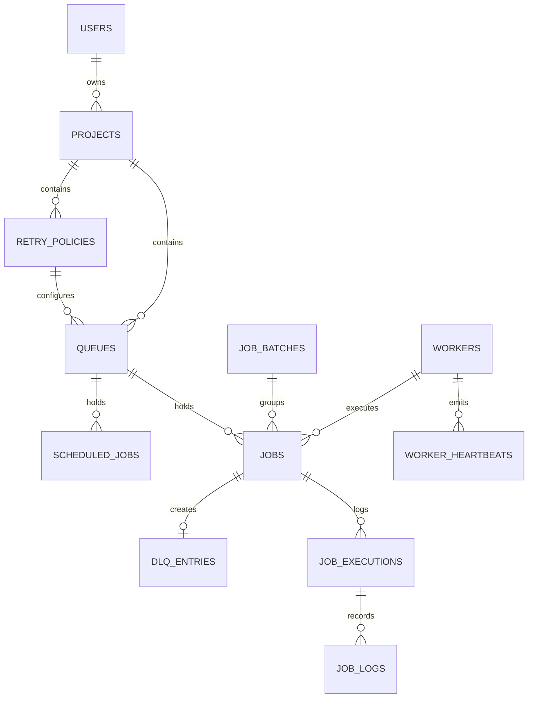

# Database Design

The Distributed Job Scheduler relies on PostgreSQL as its sole state and synchronization layer.

## Entity Relationship Diagram



## Idempotency Mechanism

A partial unique index guarantees that jobs submitted with an `idempotency_key` cannot be duplicated within the same queue.

```sql
CREATE UNIQUE INDEX ix_jobs_queue_id_idempotency_key 
ON jobs (queue_id, idempotency_key) 
WHERE idempotency_key IS NOT NULL;
```

This prevents duplicate job creation during network retries or concurrent cron materialization without forcing a lock on the table.

## Cron Deduplication

For scheduled jobs (cron or one-time), the system avoids duplicate materializations by generating a deterministic `idempotency_key` based on the schedule ID and the unix timestamp of the occurrence:
`idempotency_key = f"cron-{scheduled_job.id}-{timestamp}"`

Combined with `SELECT FOR UPDATE SKIP LOCKED` during materialization, this safely guarantees idempotent scheduling even with multiple concurrent scheduler replicas running.

## Background Scan Indexes

Each background process polls with a narrow predicate, and each predicate has a matching index:

| Scan | Predicate | Index |
|---|---|---|
| Worker claim | `queue_id = ? AND status = 'queued' AND available_at <= NOW()` | `ix_jobs_claim_query` |
| Promotion | `status IN ('scheduled','retry_wait') AND available_at <= NOW()` | `ix_jobs_due_for_promotion` (partial) |
| Lease expiry | `status IN ('claimed','running') AND lease_expires_at <= NOW()` | `ix_jobs_status_lease_expires_at` |
| Stale workers | `status = 'online' AND last_seen_at < NOW() - threshold` | `ix_workers_status_last_seen_at` |
| Due schedules | `is_active AND next_run_at <= NOW()` | `ix_scheduled_jobs_is_active_next_run_at` |

## Migrations

The schema is managed with Alembic (`backend/alembic/`). Models in `app/models/` are the source of truth, and every schema change ships as a migration:

```bash
make migration msg="add foo column"   # autogenerate a revision from model changes, then review it
make migrate                          # alembic upgrade head
make migrate-down                     # roll back one revision
make migrate-check                    # fail if models and migrations have drifted
```

`tests/integration/test_migrations.py` migrates a throwaway database to `head`, runs `alembic check` to confirm there is no drift from the models, downgrades to `base`, and upgrades again. It also asserts a single migration head.

| Revision | Summary |
|---|---|
| `001_initial` | All tables, enums, constraints and core indexes |
| `002_scan_indexes` | Workers table comment; composite `(status, last_seen_at)` worker index replaces the two single-column ones; partial promotion index on `jobs.available_at` |
