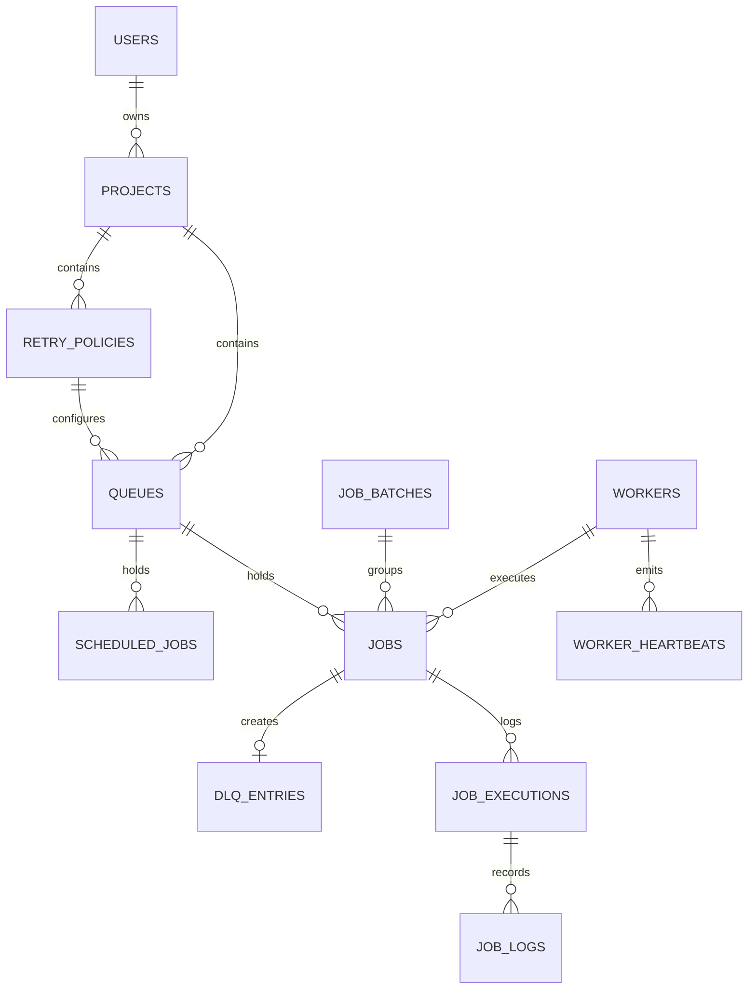

# Database Design

The Distributed Job Scheduler relies on PostgreSQL as its sole state and synchronization layer.

## Entity Relationship Diagram



## Idempotency Mechanism

A partial unique index guarantees that jobs submitted with an `idempotency_key` cannot be duplicated within the same queue.

```sql
CREATE UNIQUE INDEX ix_jobs_queue_id_idempotency_key 
ON jobs (queue_id, idempotency_key) 
WHERE idempotency_key IS NOT NULL;
```

This prevents duplicate job creation during network retries or concurrent cron materialization without forcing a lock on the table.

## Cron Deduplication

For scheduled jobs (cron or one-time), the system avoids duplicate materializations by generating a deterministic `idempotency_key` based on the schedule ID and the unix timestamp of the occurrence:
`idempotency_key = f"cron-{scheduled_job.id}-{timestamp}"`

Combined with `SELECT FOR UPDATE SKIP LOCKED` during materialization, this safely guarantees idempotent scheduling even with multiple concurrent scheduler replicas running.
