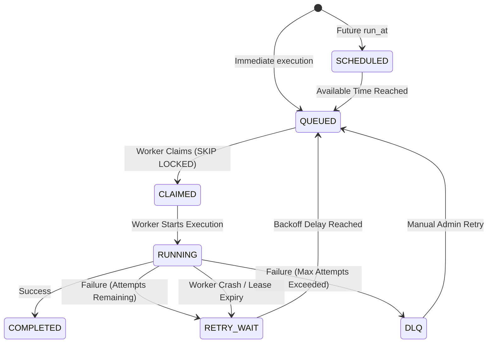
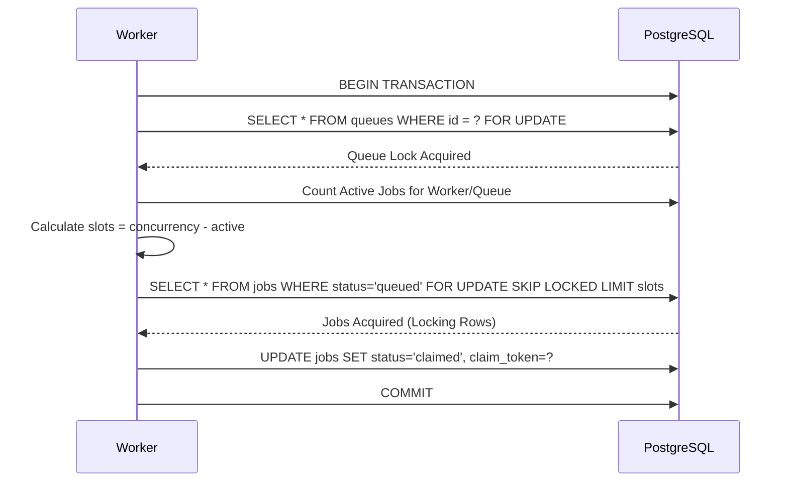

# Design Decisions

## 1. Why no Redis, Celery, or Kafka?
While standard queue architectures use Redis (for speed) or Kafka (for distributed event logs), this project restricts itself entirely to PostgreSQL. This simplifies the deployment topology and leverages ACID transactions for both state tracking and message brokering. While this reduces total maximum throughput compared to in-memory queues, PostgreSQL 16 `SKIP LOCKED` easily supports hundreds or thousands of jobs per second with absolute correctness, making it perfectly suitable for most enterprise background job systems.

## 2. Job Lifecycle State Machine

Jobs move through a strict, transactionally guaranteed state machine:

## 3. Worker Crash Recovery and Leases
To prevent "zombie" jobs when a worker is OOM-killed, hardware crashes, or network partitions occur:
- Workers periodically "heartbeat" their existence.
- Claimed/Running jobs have a `lease_expires_at` timestamp.
- A background worker thread continually renews the lease while the handler runs.
- A background `Reaper` process scans for jobs where `lease_expires_at < NOW()`. It strips ownership and routes them to `RETRY_WAIT`.

## 4. Sequence Diagram: Atomic Claiming

